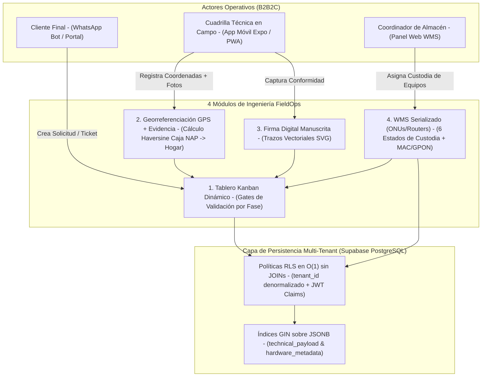

# FieldOps — Multi-Tenant FTTH Field Operations & Serialized WMS Blueprint (`fieldops-isp-blueprint`)

[](https://expo.dev/)
[](https://www.typescriptlang.org/)
[_Multi--Tenant_RLS_%2B_GIN-336791?style=flat&logo=postgresql&logoColor=white)](https://supabase.com/)

Blueprint arquitectónico de marca blanca (**React Native / Expo / Web PWA + TypeScript estricto + Supabase PostgreSQL**) que implementa los **4 módulos críticos de operaciones de campo y almacén (WMS)** para empresas de telecomunicaciones (FTTH / ISPs), gobernados por **aislamiento Multi-Tenant con políticas Row-Level Security (RLS) en `O(1)` sin JOINs**.

---

## 1. Arquitectura Multi-Rol (B2B2C) sobre Fuente Única de Verdad



---

## 2. Los 4 Componentes Técnicos Extraídos

1. **Tablero Kanban Dinámico con *Field Gates* ([`src/components/DynamicKanbanBoard.tsx`](./src/components/DynamicKanbanBoard.tsx)):**
   * Impide que una orden de instalación avance a `PENDING_ACTIVATION` o `ACTIVE_SUBSCRIBER` si no cumple los 4 candados de auditoría en campo: coordenadas GPS de caja NAP y domicilio, mínimo 2 fotografías de evidencia (puerto NAP y lectura de potencia óptica dBm), serial GPON asignado desde la custodia del técnico y firma manuscrita del suscriptor.
2. **Georreferenciación GPS y Cálculo Haversine ([`src/components/GpsPhotoEvidenceModule.tsx`](./src/components/GpsPhotoEvidenceModule.tsx)):**
   * Calcula en tiempo real la distancia geodésica en metros entre la caja de distribución óptica (NAP) y la residencia del cliente para auditar el metraje de acometida de fibra óptica (*Drop*).
3. **Captura de Firma Digital Manuscrita ([`src/components/DigitalSignaturePad.tsx`](./src/components/DigitalSignaturePad.tsx)):**
   * Valida la densidad vectorial del trazo SVG (`M` / `L` commands) para evitar cierres vacíos o toques accidentales en pantalla.
4. **WMS de Equipos Serializados ([`src/components/SerializedWmsModule.tsx`](./src/components/SerializedWmsModule.tsx)):**
   * Valida formato de seriales GPON de 12 caracteres (`ZTEG`, `HWTC`, `ALCL`, etc.) y direcciones MAC IEEE 802 a través de 6 estados de custodia (*Almacén Central $\rightarrow$ Sucursal $\rightarrow$ Custodia Técnico $\rightarrow$ Instalado en Cliente $\rightarrow$ Devolución $\rightarrow$ Recuperado*).

---

## 3. Patrón de Base de Datos: RLS Multi-Tenant en `O(1)` sin JOINs

En sistemas SaaS multi-tenant tradicionales, evaluar permisos en una tabla hija (`work_orders` $\rightarrow$ `boards` $\rightarrow$ `branches` $\rightarrow$ `tenants`) obliga al planificador de PostgreSQL a ejecutar múltiples `JOIN` por cada fila leída, degradando el rendimiento exponencialmente.

En [`supabase/migrations/001_fieldops_multitenant_rls.sql`](./supabase/migrations/001_fieldops_multitenant_rls.sql):
* `tenant_id` se propaga de forma denormalizada en las 5 tablas (`tenants`, `profiles`, `work_orders`, `inventory_items`, `audit_logs`).
* La política RLS evalúa `USING (tenant_id = public.current_user_tenant_id())` directamente contra el índice compuesto `(tenant_id, phase)` o `(tenant_id, custody_state)`, manteniendo tiempo de resolución constante `O(1)` e indexación `GIN` sobre esquemas dinámicos `JSONB`.

---

## 4. Verificación y Ejecución de Pruebas Locales

```bash
git clone https://github.com/anthony-huice/fieldops-isp-blueprint.git
cd fieldops-isp-blueprint
npm install

# 1. Verificar tipado estricto TypeScript
npm run typecheck

# 2. Compilar y ejecutar suite de pruebas de dominio (GPON/MAC, Haversine, Kanban Gates y Firma SVG)
npm run build
npm test
```

---

## 👤 Autor

**Anthony Yariff Huice Martínez** — *Desarrollador Full-Stack & Móvil*  
[LinkedIn](https://www.linkedin.com/in/anthony-huice) · [GitHub](https://github.com/anthony-huice) · [anthonyhuice92@gmail.com](mailto:anthonyhuice92@gmail.com)
